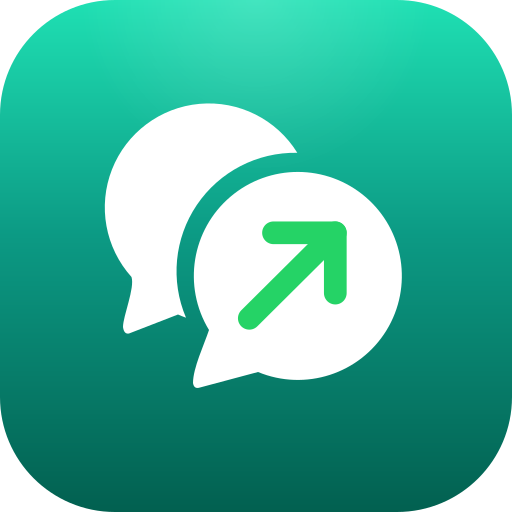
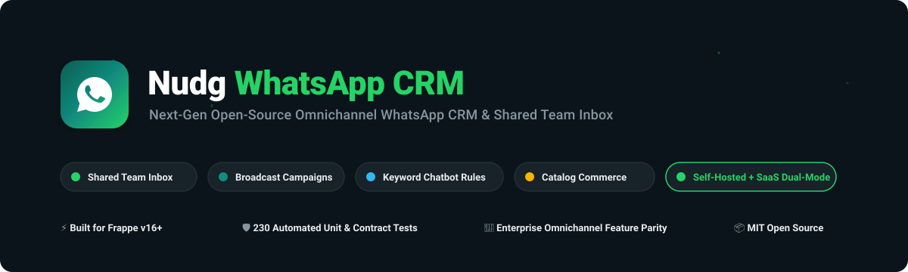

<div align="center" markdown="1">



# NUDG

**NUDG – Every conversation moves business forward.**

[](https://frappeframework.com/)
[](nudg/tests/)
[](frontend/)
[](license.txt)

[Try it](https://nudg.mytra.money) · [Getting started](#getting-started) · [The daily flow](#the-daily-flow) · [Install](#install-for-admins)

</div>



NUDG helps sales, support, and marketing teams manage customer conversations over WhatsApp in one shared workspace — with live agent presence, canned replies, standard UTM campaign broadcasts, and catalog commerce.

It is built for companies that want an enterprise customer engagement desk with **zero third-party SaaS markups**, running either as a **standalone SaaS platform (`nudg.mytra.money`)** or **directly inside your own Frappe Framework instance**.

---

## Getting started

1. **Open NUDG**: Navigate to [nudg.mytra.money](https://nudg.mytra.money) (or `http://your-site.localhost:8000/nudg`).
2. **Connect your WhatsApp Account**: Go to **Integrations** to connect your Meta WhatsApp number in 1 click using **Embedded Signup**, or manually enter your Meta Phone Number ID, WhatsApp Business Account ID (WABA ID), and Permanent Access Token.
3. **Invite your team**: Assign team members the **WhatsApp User** role for support/sales agents, or **WhatsApp Manager** for team leads. Standard User Permissions isolate accounts automatically.
4. **Configure Quick Replies**: Add canned responses with `/` shortcut triggers (e.g. `/greet`, `/pricing`, `/refund`) to answer routine queries in seconds.
5. **Start messaging**: Inbound messages arrive in real time with audio chimes, unread tab badges, and round-robin agent routing.

---

## The daily flow

```
Inbound Message  →  Round-Robin Routing  →  Shared Team Inbox  →  Dynamic Document Context  →  Resolution
```

### Shared Team Inbox (`/conversations`)

Your daily mission control for customer conversations:

- **Lifecycle Filter Tabs**: Filter instantly across `Needs Reply`, `Active (24h Window)`, `Template Only`, and `Closed / Resolved`.
- **Live Collision & Typing Presence**: Visual indicators warn agents when a teammate is actively viewing or typing on a conversation, preventing duplicate replies.
- **Audio Chime & Tab Badges**: Audible notification chime (`new-message.mp3`) and dynamic unread counter in the browser tab title alert agents to new inbound messages.
- **Private Internal Notes**: Add internal collaboration notes on customer threads that are visible only to teammates, never to the customer.
- **Quick Replies (`/`)**: Press `/` in the message composer to search and insert pre-approved canned responses instantly.
- **Dynamic Frappe Document Linking**: Connect any conversation to any Frappe record (User, Issue, Customer, Lead, Quotation) with deep links into Frappe Desk.

### Broadcast Campaigns (`/marketing`)

Reach your audience at scale using standard Frappe models:

- **Direct `UTM Campaign` Standard Integration**: Native Frappe marketing workflow without duplicate custom campaign doctypes.
- **Meta Approved Templates**: Seamlessly pick approved templates from `WA Template` with dynamic parameter mapping (`{{1}}`, `{{2}}`).
- **Real-Time Funnel Telemetry**: Track Sent, Delivered, Read, and Failed counts in real time.
- **Automated Opt-Out Suppression**: Automatically skips recipients who sent `STOP` or revoked marketing consent.
- **Scheduled Background Dispatch**: Background workers process scheduled campaign dispatch queues via Frappe cron.

### Commerce & Catalogs (`/integrations/catalogs`)

Turn conversations into sales with native WhatsApp Commerce:

- **Single-Product Messages (SPM)**: Share featured products with image, title, price, and a direct purchase button inside WhatsApp.
- **Multi-Product Messages (MPM)**: Send categorized product catalogs allowing customers to browse inventory without leaving the chat.
- **Inbound Cart Webhook**: Listens for Meta's `order` webhook payload and renders structured order summaries in the chat thread.
- **Optional ERPNext Sync**: 1-click import from ERPNext `Item` when available; 100% standalone catalog management in pure SaaS mode.

### Automations & Smart Routing (`/automation`)

Put routine operations on autopilot:

- **Keyword Triggers**: Automatically reply or re-route when incoming messages match keywords (`Exact`, `Contains`, `Starts With`, or `Regex`).
- **ReDoS Protection**: Advanced regex execution guard prevents catastrophic backtracking.
- **Workload Round-Robin**: Intelligently distributes inbound customer inquiries across active agents with workload balancing.
- **Consent Compliance**: Automated handling of opt-out (`STOP`, `UNSUBSCRIBE`, `CANCEL`) and opt-in (`START`, `YES`).

---

## ⚔️ NUDG vs Other Commercial Solutions

| Feature | Other Commercial Solutions | NUDG (Ours) |
| :--- | :---: | :---: |
| **Shared Team Inbox** | Limited / Per-Agent Add-on | ✅ **Agent collision detection, live presence, audio alerts, and round-robin routing** |
| **Broadcast Campaigns** | Per-Message Surcharge | ✅ **Direct integration with standard `UTM Campaign` with dynamic parameters (`{{1}}`, `{{2}}`)** |
| **Dynamic Document Linking**| ❌ No Frappe Integration | ✅ **Link any Frappe DocType dynamically (Customer, Lead, Issue, User)** |
| **WhatsApp Catalog Commerce**| Partial | ✅ **Single-Product (SPM) & Multi-Product (MPM) messages + Inbound cart webhook** |
| **ERPNext Catalog Sync** | ❌ No ERPNext Support | ✅ **Optional 1-click import from ERPNext `Item` (with full manual fallback)** |
| **Keyword Automations** | Basic | ✅ **Exact, Contains, Starts With, and ReDoS-protected Regex triggers** |
| **Opt-Out Compliance** | Partial | ✅ **Automated `STOP` / `START` consent management & broadcast suppression** |
| **Audio & Tab Alerts** | ❌ No / Basic Chime | ✅ **Audible incoming chime (`new-message.mp3`) + dynamic unread tab badge** |
| **Role-Based UI Isolation** | Limited | ✅ **Strict separation: `WhatsApp Manager` (Admin) vs `WhatsApp User` (Agent)** |
| **Open Source & Extensible** | ❌ Proprietary (SaaS Lock-in) | ✅ **100% Open-Source (MIT) on standard Frappe Framework** |

---

## Roles (who can do what)

| Role | Typical use |
| :--- | :--- |
| **WhatsApp User** | Day-to-day: shared inbox, message replies, quick replies (`/`), contact tagging, internal notes, audio chimes |
| **WhatsApp Manager** | Team setup, round-robin rules, UTM broadcasts, automations, WABA credentials |
| **System Manager** | Full access including Desk and site maintenance (for administrators) |

Day-to-day agent work happens in the NUDG app (`/nudg`), with administrative views (`/marketing`, `/automation`, `/integrations`) automatically hidden from regular agents.

---

## ERPNext integration (optional)

ERPNext is **completely optional**. NUDG has **zero hard dependencies on ERPNext or Frappe CRM**:

- **Pure SaaS Mode (`nudg.mytra.money`)**: Runs on vanilla Frappe Framework v16+. Catalog items, quick replies, and UTM campaigns are managed completely independently.
- **Self-Hosted Mode (with ERPNext)**: If ERPNext is detected on your bench, NUDG automatically enables:
  - 1-click **"Import from ERPNext Items"** on WhatsApp Catalog.
  - Quick document linking to Leads, Quotations, Sales Orders, and Issues.

---

## Install (for admins)

### Prerequisites
- **Frappe Framework**: >= v16.0 (Strictly Frappe v16+, no v15 support)
- **Node.js**: >= 20 (recommended: v24)
- **Python**: >= 3.10
- **Upstream App**: `whatsapp` ([frappe/whatsapp](https://github.com/frappe/whatsapp))

### Bench Installation

```bash
cd frappe-bench

# 1. Fetch upstream whatsapp and nudg
bench get-app https://github.com/frappe/whatsapp
bench get-app https://github.com/nagaraj-62/nudg

# 2. Install apps on your site
bench --site <site> install-app whatsapp
bench --site <site> install-app nudg

# 3. Run database migrations
bench --site <site> migrate
```

### Build Frontend Assets

```bash
cd apps/nudg/frontend
yarn install
yarn build:frappe
bench --site <site> clear-cache
```

### Seed SaaS Demo Data (Optional)

```bash
bench --site <site> execute nudg.seed_saas_data.seed_all
```

---

## Testing & Verification

NUDG includes a hermetic mock testing harness simulating Meta Graph API v18.0+:

```bash
# Run backend unit and contract tests (198 passing)
cd /path/to/frappe-bench
PYTHONPATH=apps/nudg ./env/bin/python -m unittest discover -s apps/nudg/nudg/tests -p "test_*.py"

# Run frontend Vitest specs (42 passing)
cd apps/nudg/frontend
yarn test
```

---

## About Mytra

NUDG is developed as an open-source customer communication platform:
- Cloud Platform: [nudg.mytra.money](https://nudg.mytra.money)
- Powered by: [Mytra](https://mytra.money)

---

<div align="center">

**Turn WhatsApp into your team's most effective customer engagement channel.**

</div>
