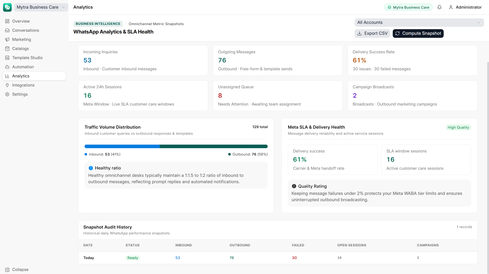

**Analytics** is a saved snapshot, not a live ticker. The page keeps showing the last ready snapshot until **Compute Snapshot** finishes a new one.

## Read the six cards

| Card | Meaning |
| --- | --- |
| Incoming Inquiries | Customer messages in |
| Outgoing Messages | Replies and templates out |
| Delivery Success Rate | How many outgoing messages were delivered |
| Active 24h Sessions | Threads whose service window is still open |
| Unassigned Queue | Threads with no assignee |
| Campaign Broadcasts | Campaign sends in the snapshot |

**Traffic Volume Distribution** splits the same messages into inbound and outbound. **Meta SLA & Delivery Health** repeats the delivery rate and the open windows so you can see them next to each other.

The account dropdown filters the snapshot. **All Accounts** is every number you are allowed to see. An agent and a manager do not see the same list.

## Make a new snapshot

Click **Compute Snapshot**. The work runs in the background. A banner stays up while it generates, and the page keeps the previous numbers until the new snapshot is ready. **Export CSV** downloads the one on screen.

The line under the title is the snapshot date, when it was generated, and its id. **Snapshot Audit History** under the cards is the earlier runs.

:::note
No account yet means there is nothing to measure. Connect a number from [Integrations](../integrations/connect-a-number.md), then compute the first snapshot.
:::

**Overview** is the live queue. **Analytics** is the snapshot you can export. Use Overview during the day.
