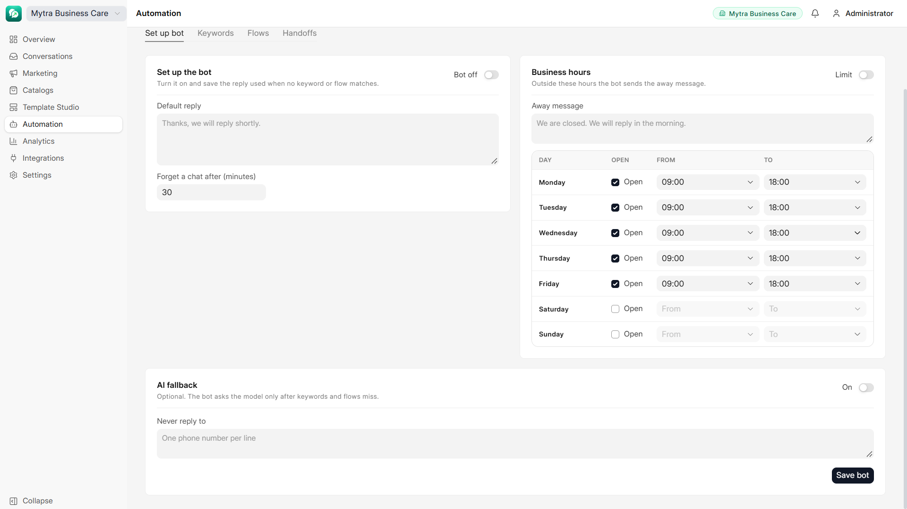
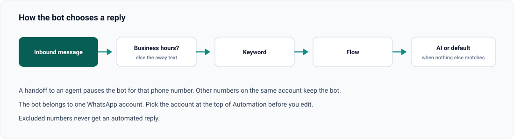

**Automation** answers on one WhatsApp account. Pick that account in the dropdown before you change anything. Keywords, flows, hours, and the default reply belong to the account, not to the whole site.

The tabs are the whole feature:

| Tab | What you set |
| --- | --- |
| Set up bot | On or off, the default reply, how long a session lasts, business hours, AI |
| Keywords | A word that sends a reply or starts a flow |
| Flows | A short sequence of questions |
| Handoffs | Chats the bot has given to an agent |

## Turn it on

1. Choose the WhatsApp account.
2. On **Set up bot**, switch **Bot off** to on.
3. Write the **Default reply**. That text goes out when no keyword and no flow matches.
4. Set **Forget a chat after (minutes)**. After that many quiet minutes the next message is a new session. The minimum is 5. The screen shows 30.
5. Save.

**Limit** on the business-hours card sends the away message outside the days and times in the table. Leave it off and the bot answers whenever a message arrives. Saturday and Sunday in the picture are closed because **Open** is unchecked.

## What it will not do

- It does not reply to numbers on the excluded list.
- Assigning the thread to an agent pauses the bot for that number. Other numbers on the same account keep it. See [Handoffs](handoffs.md).
- Outside the 24-hour window, only an approved template can go out. The bot does not override that.

Connect a number before you open this page. With no account, there is nothing to configure.

Read [Keywords](keywords.md), [Flows](flows.md), and [Business hours and AI](business-hours-and-ai.md).
