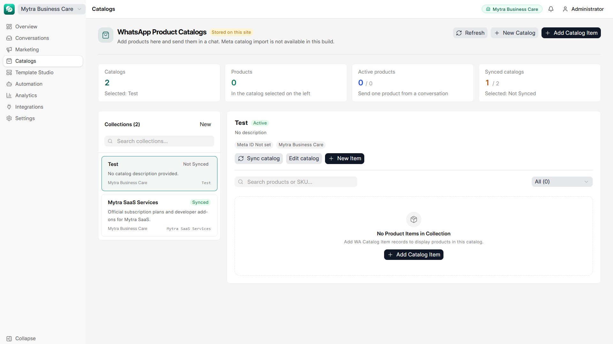

**Catalogs** is the product list an agent can drop into a chat. It is for WhatsApp Manager. Products are stored on this site. The screen says so under the title.

## The page

The left column is **Collections**. Search them, or click **New** for another catalog. Each card shows the WhatsApp account it belongs to and whether it is **Synced**.

The right column is the collection you selected:

| Control | Use |
| --- | --- |
| Meta ID | The Meta catalog id, when this collection is also a Meta catalog. **Not set** means the products live only in Nudg. |
| Sync catalog | Pull the Meta catalog when an id is set. |
| Edit catalog | Name, account, and description. |
| New Item / Add Catalog Item | A product on this collection: name, price, and the details a send needs. |

The four cards above the columns count catalogs, products in the selected collection, products that can be sent, and how many collections are synced.

:::note
This build adds products on the site. If Meta catalog import is marked unavailable, use **Add Catalog Item** instead of waiting for a sync.
:::

## Send a product

From a thread whose [window is open](../conversations/service-window.md), use **Catalog** in the composer and pick an item from a collection on that account. The customer receives a product message.

If the window is closed, send a template first. A product message follows the same 24-hour rule as any other free-form message.

When ERPNext is installed on the same site, items can be copied into a collection. That copy is not kept in sync by itself. See [ERPNext](../integrations/erpnext.md).
