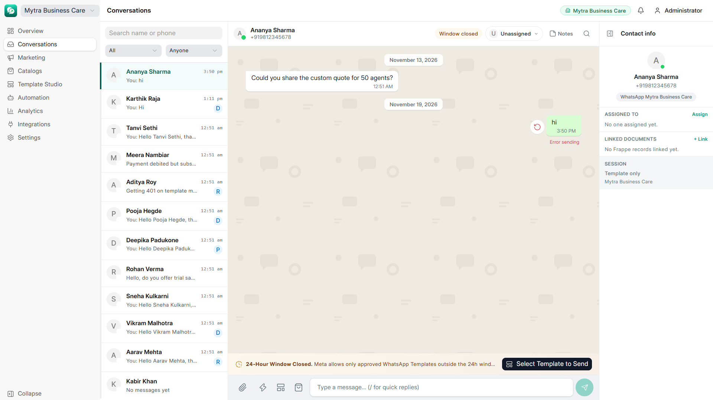

**Conversations** is the shared inbox. The left column is every thread on the numbers you can use. The right column is the thread you clicked.

Open it from the sidebar, from **Open Inbox** on Overview, or from a **Reply** button on a queue row.

## Use the left column

1. Search by name or phone.
2. Filter the list. **All**, **Needs reply**, **Window open**, **Template only**, **Failed**, and **Blocked** are the states.
3. Narrow it to one assignee with the second dropdown.
4. Click a row. The thread opens on the right. You do not leave the page.

The list flips a thread from **Window open** to **Template only** when the 24 hours run out. You do not have to refresh for that.

## Use the right column

The header shows the contact and a badge for the window: **Window closed** or the open window. Next to it:

| Control | What it does |
| --- | --- |
| Unassigned | Give the thread to an agent, or clear it |
| Notes | A comment the customer never receives |
| Search | Find text inside this thread |

The composer at the bottom sends the reply. `/` opens quick replies. **Catalog** sends a product. When the window is closed, the amber bar replaces a normal send with **Select Template to Send**.

:::caution[The amber bar is Meta]
A typed reply is rejected after 24 hours. Send an approved template. When the customer writes back, the window opens and the composer accepts text again. See [The 24-hour window](service-window.md).
:::

If another agent has the thread open, you see that they are viewing or typing. A handoff banner means Automation has paused the bot for this number. Reply as usual. Resume the bot from [Handoffs](../automation/handoffs.md).

## Linked Frappe records

The contact side of the thread lists DocTypes already tied to it, such as a Lead or a Sales Invoice. A link appears after you send a template that is tied to a document. Open the record from that list when your role can see the DocType.

## Keep going

- [Replying](replying.md) — text, media, and templates from this composer
- [Quick replies](quick-replies.md) — the `/` menu
- [Assignment and notes](assignment-and-notes.md) — who owns the thread
