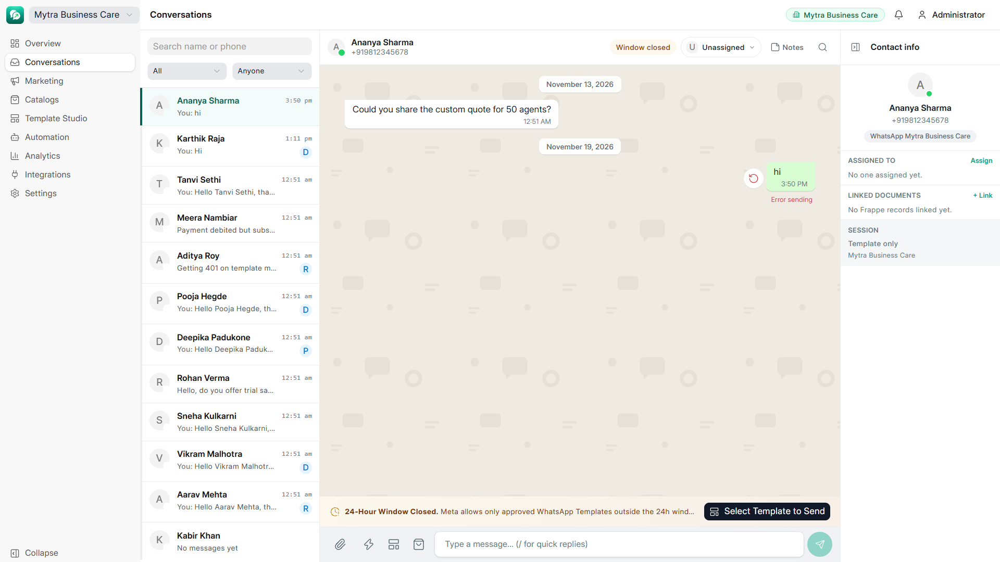

Open a thread in **Conversations** and use the composer at the bottom. The thread in the screenshot below is closed, so the composer is the template button. On an open window the same spot is a text box, with **Catalog**, quick replies, and **Send**.

## A normal reply

Use this while the [window is open](service-window.md). Type the message and send it. The customer sees it on WhatsApp. Delivery updates (sent, delivered, read, failed) come back from Meta and show on the message.

You can also:

- Search inside the open thread
- Send a product from a catalog the account is allowed to use
- Insert a [quick reply](quick-replies.md) with `/`

## A template reply

Use this when the filter says **Template only**, or whenever you want a pre-approved message. Open the template picker from the composer. Filter by **Utility** or **Marketing**, pick a template, fill its parameters, and send.

The same templates are listed in [Template Studio](../template-studio/overview.md). Studio is the place to review the wording and the variables before you send. The composer is the place to send one into the thread you already have open.

## Who can reply

A **WhatsApp User** can reply on threads they are allowed to see. A **WhatsApp Manager** can reply as well, and can connect numbers and run campaigns. The signed-in user only sends from numbers they are permitted to use.
