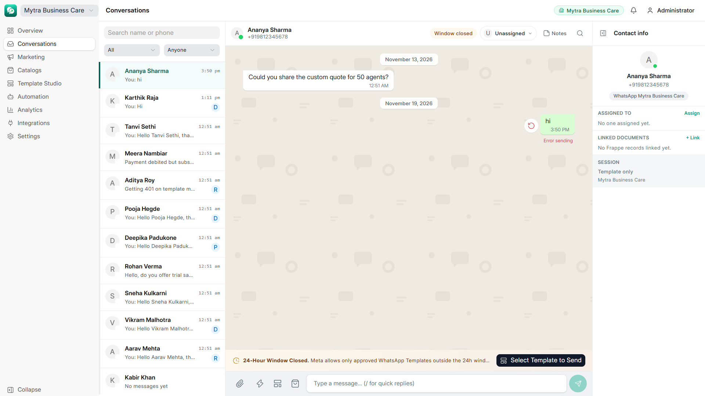
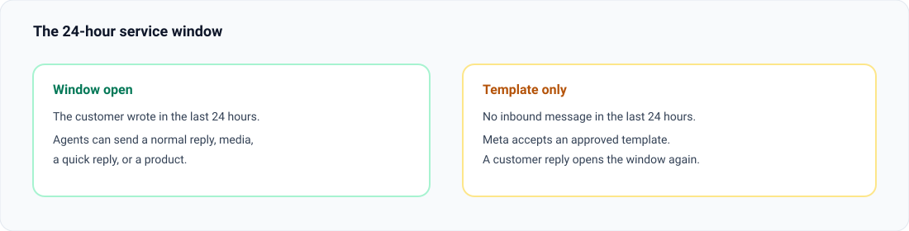

WhatsApp allows a free-form reply for 24 hours after the customer's last message. Nudg tracks that per conversation. This is a Meta rule. Nudg does not extend it.

In the inbox the state is a badge on the thread. **Window closed** comes with an amber bar on the composer: Meta will only accept an approved template. **Select Template to Send** is the button on that bar. A thread that still says the window is open keeps the normal text box.

| Window | What you can send |
| --- | --- |
| Open | Text, media, a quick reply, a reaction, a product |
| Closed | An approved template only. A free-form message is rejected |

The inbox filter **Window open** is the first case. **Template only** is the second.

## How the window opens again

Any new inbound message starts another 24 hours from that message. A template you send does not open the window by itself. The customer's reply does.

Overview and Analytics both count conversations whose window is still open, so the team can see who can still be answered without a template.

## When a send fails because the window is closed

The thread moves to **Failed** if Meta rejects the message. The usual cause is a free-form reply after the window closed. Open the thread and send an approved template instead. **Integrations → Logs** records the rejection for a manager.
