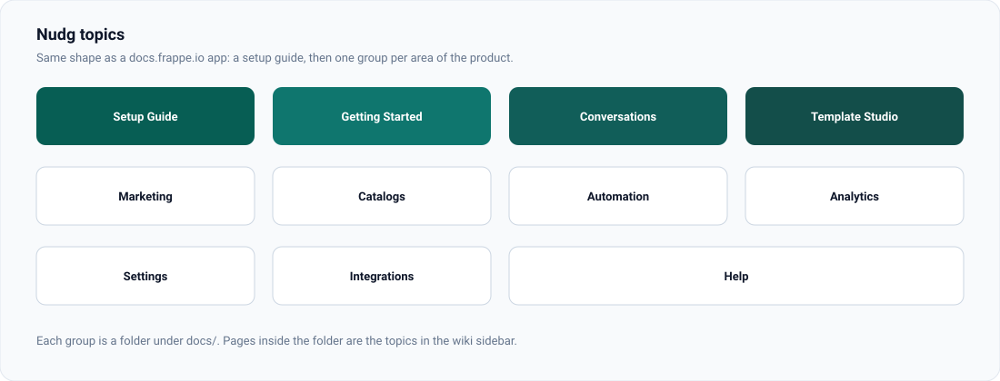

Nudg follows the usual Frappe app layout. The Python package is the app. The Vue app is the screen people use. This `docs/` folder is the wiki source, in the same way [Frappe Wiki](https://docs.frappe.io/wiki/github-sync/folder-structure) reads a docs folder into a sidebar.

```text
nudg/
  nudg/                  Python package
    hooks.py             App hooks, roles, and the WhatsApp overrides
    install.py           Roles and custom fields created on install
    api.py               Whitelisted methods used by the page
    desk_api.py          Inbox, campaigns, catalogs, and account setup
    www/nudg.html        The /nudg website page
    nudg/doctype/        Nudg DocTypes (chatbot, catalog, quick reply, ...)
    services/            Campaigns, consent, assignment, analytics
    integrations/        WhatsApp adapter, webhook, ERPNext
    chatbot/             Keyword match, flows, and the AI reply
    patches/             Schema changes applied by migrate
  frontend/              Vue 3 app (Conversations, Marketing, Settings, ...)
  docs/                  This documentation
    .wiki.yml            Sidebar groups, one per product area
    images/              Diagrams used by the pages
  public/                Desk scripts and the app icon
```

## How the folders map to the product

| Folder | Topic in this wiki |
| --- | --- |
| `frontend/src/pages` | One page for each sidebar item in the app: Overview, Conversations, Marketing, Catalogs, Template Studio, Automation, Analytics, Integrations, Settings |
| `nudg/services` | Campaigns, consent (`STOP` / `START`), assignment, analytics |
| `nudg/chatbot` | Keywords, flows, sessions, and AI replies |
| `nudg/integrations` | The official WhatsApp app, the webhook wrapper, and ERPNext |
| `nudg/nudg/doctype` | Records Nudg owns, such as WA Quick Reply, WA Catalog, and WA Chatbot |
| `docs/<group>` | One wiki group. Each Markdown file in the folder is a topic |

Messages, templates, and the WhatsApp account itself stay on the official `whatsapp` app. Nudg does not keep a second copy of the token.

## Docs folder

`.wiki.yml` at the top of `docs/` is the sidebar. Each `label` is a group. Each Markdown file in the folder is a topic, ordered by `sidebar_position` in the front matter. `overview.md` is the first page of a group.


