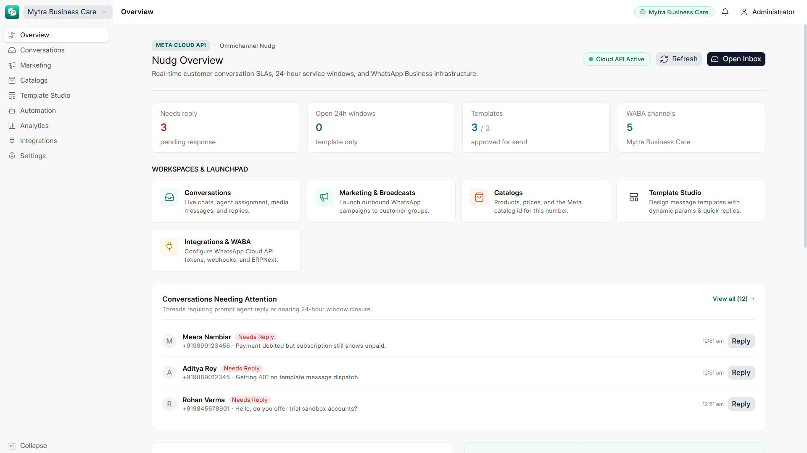

Nudg is the shared WhatsApp desk for a team. Open it at [/nudg](/nudg). Replies, approved templates, campaigns, catalogs, and the bot are sections of that one screen, not separate products.

The pictures in this guide are from a running Nudg site. Your numbers, names, and templates will differ. The layout is the same.

## Read the home screen first

Overview is the map. Four cards across the top tell you what to do next:

| Card | Act on it |
| --- | --- |
| Needs reply | Open **Conversations**. Someone is waiting. |
| Open 24h windows | These threads still accept a normal reply. |
| Templates | How many approved templates you can send. |
| WABA channels | Which number is the default. Switch numbers with **All numbers** at the top. |

Under the cards, the launchpad jumps to Conversations, Marketing, Catalogs, Template Studio, and Integrations. The list under that is the same queue as the inbox, with a **Reply** button on each row.

:::tip[Do this now]
Click **Open Inbox**, or click **Needs reply**. You land in [Conversations](conversations/overview.md) on the threads that are waiting.
:::

## Where each job lives

| You want to | Open |
| --- | --- |
| Answer a customer | [Conversations](conversations/overview.md) |
| Send a pre-approved message | [Template Studio](template-studio/overview.md) |
| Message a list | [Marketing](marketing/overview.md) |
| Send a product | [Catalogs](catalogs/overview.md) |
| Let a bot answer first | [Automation](automation/overview.md) |
| See whether sends are landing | [Analytics](analytics/overview.md) |
| Save a `/` reply, or add an agent | [Settings](settings/overview.md) |
| Connect a number or ERPNext | [Integrations](integrations/overview.md) |

A customer message arrives, the thread shows in Conversations, and the team replies while the [24-hour window](conversations/service-window.md) is open. After it closes, the composer asks for a template. A manager can also start the conversation from Marketing.

People who send `STOP` are skipped by later campaigns. `START` opts them back in. See [Recipients and consent](marketing/recipients-and-consent.md).

## If you are installing it

[Your first steps](setup-guide/your-first-steps.md) is the product tour. [Installation](getting-started/installation.md) is the bench. [Common issues](help/common-issues.md) is the page to open when a screen is empty or a send is rejected.
