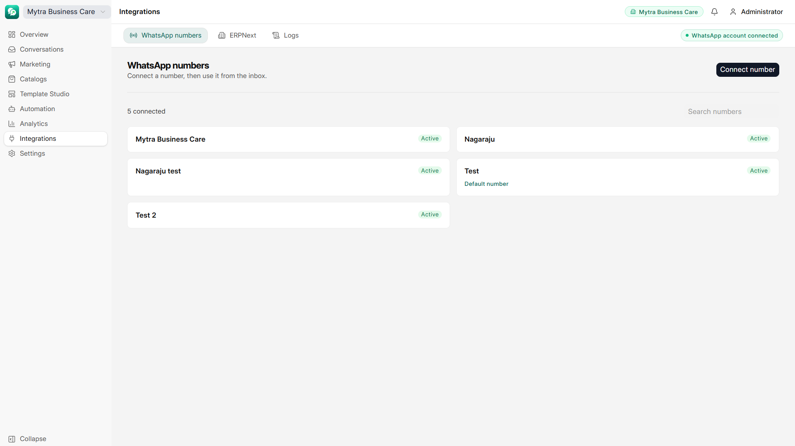

Open **Integrations → WhatsApp numbers** and click **Connect number**. The cards already on the page are the accounts the inbox can use. One of them is marked **Default number**.

## Login with Facebook

Choose **Login with Facebook** when Embedded Signup is configured for the site. Finish the Facebook window. Do not close the Nudg page while it is open.

When it succeeds, Nudg stores the account and shows the account name. If the WhatsApp Business app is still copying chats in, that can take a few minutes. The signup PIN is shown once. Save it somewhere the System Manager can find it later.

If Facebook does not return a code, close the window and start again. If the Facebook SDK does not load, the page says so. Check that the site can reach Facebook and that the Meta app id on the signup settings is the one for this site.

## Credentials you already have

Choose **I already have credentials** when the number is already on the Cloud API.

Required:

- Account name
- Phone number ID
- Access token

Optional:

- WhatsApp account ID
- Meta app ID

The token is saved on the WhatsApp account and is not shown again.

## More than one number

Each number is its own account. Conversations, templates, campaigns, catalogs, and the bot are filtered by the account you pick. A user only sees numbers they are allowed to use.

A System Manager may set a **Default account** under **Settings → WABA Profile**. Leave it empty when several clients share the site. It is only a fallback when a webhook or a send does not name a number and the phone id does not match. It does not give every user access to that number.

## Remove or edit

A manager edits the account from **Settings → WABA Profile**. Removing a number stops new sends from that number. It does not delete the WhatsApp thread history Meta already has.
