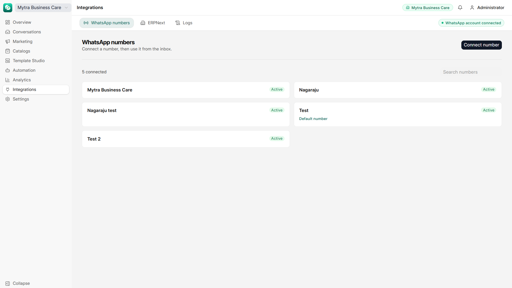
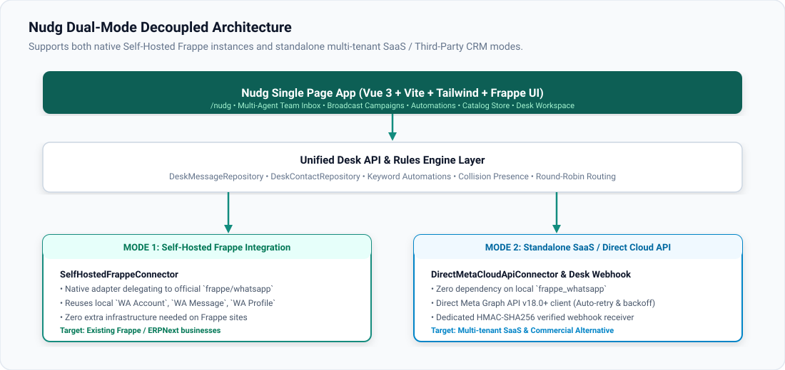

**Integrations** is for WhatsApp Manager. The three sections are tabs on one page: **WhatsApp numbers**, **ERPNext**, and **Logs**.

**Connect number** adds another account. The green pill is **WhatsApp account connected** once at least one number is active. Search the cards when the list is long.

The three sections are:

| Section | Use |
| --- | --- |
| WhatsApp numbers | Connect a number with Facebook or with credentials you already have |
| ERPNext | Point Nudg at an ERPNext site and send a template when a document changes |
| Logs | Message and webhook audit, when your user is allowed to read logs |

The header shows whether any account is connected. Overview shows the same fact as Cloud API Active, Setup Required, or Demo Preview Mode.

Nudg works without ERPNext. The inbox, templates, and campaigns do not read ERPNext until you add a site here or import items on a bench that already has ERPNext installed.

## What stays outside Nudg

The access token, the webhook secret, and the message log of record live on the official WhatsApp app. Nudg calls that app to send and to receive. A System Manager who needs the raw DocType opens Desk. Everyone else stays in `/nudg`.
