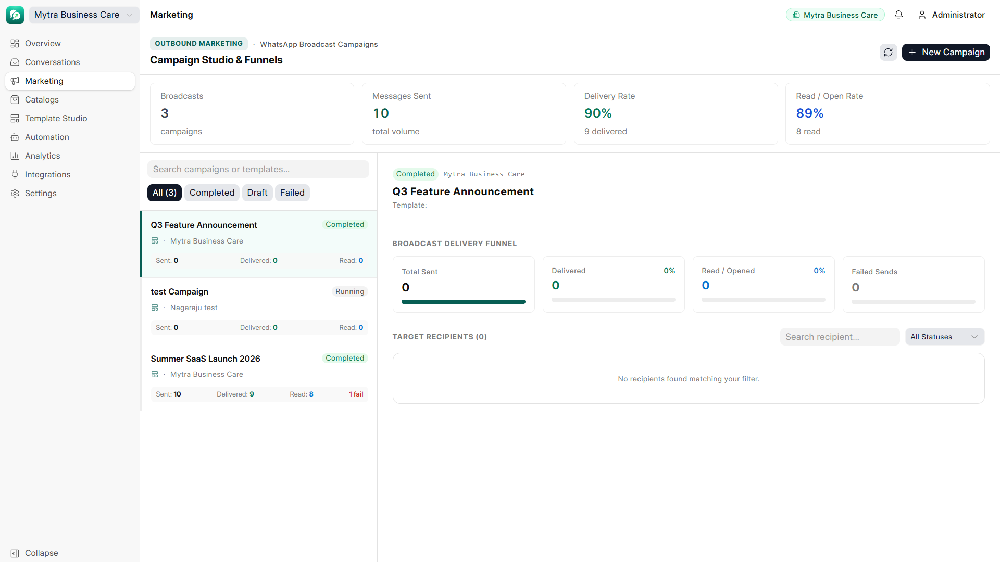

**Marketing** sends one approved template to many people. It is for WhatsApp Manager. The screen is a list of campaigns on the left and the selected campaign's funnel on the right.

## Read the top row before you create one

| Card | What it is counting |
| --- | --- |
| Broadcasts | Campaigns on this site |
| Messages Sent | Outbound template sends |
| Delivery Rate | Delivered divided by sent |
| Read / Open Rate | Read divided by delivered |

The filters under the search box are **All**, **Completed**, **Draft**, and **Failed**. A running campaign shows **Running** on its row. Completed ones show **Completed**.

## Open a campaign

Click a row. The right side names the template, the account, and the funnel: sent, delivered, read, failed. **Target recipients** is the per-number table. Filter that table by status or search a name.

The totals on the card and the funnel can disagree for a moment. The card is the rollup Meta has already reported. The funnel is this campaign's own rows.

:::tip[Start one]
**New Campaign** asks for a name, the WhatsApp account, a recipient list, an approved template, and a start date. Nothing is sent until you run it. The steps are in [Campaigns](campaigns.md).
:::

Recipients who sent `STOP` are not sent. See [Recipients and consent](recipients-and-consent.md).
