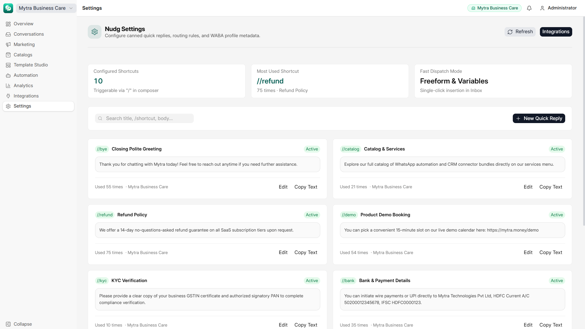
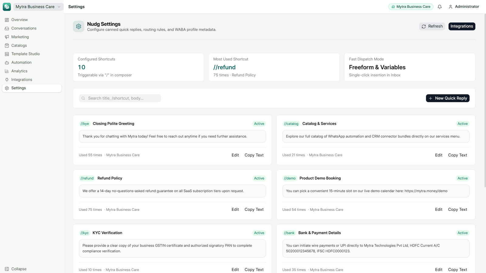

**Settings** prepares the team, the shortcuts, and the account. Replies still happen in **Conversations**. The **Integrations** button on this page jumps to the numbers.

## Tabs

| Tab | What you set | Who |
| --- | --- | --- |
| Quick Replies | Saved replies and the shortcut | A manager maintains the list. Anyone in the inbox can insert one |
| Routing & Assignment | How ownership works | Read it, then assign from the thread |
| Team & Agents | Who has WhatsApp User or WhatsApp Manager | WhatsApp Manager |
| WABA Profile | Connected numbers, and site-wide API and webhook fields | Profile for managers. API and webhook fields for System Manager |

## Quick replies

**New Quick Reply** asks for a title, a shortcut, and the body. The cards show the shortcut, the text, the account, and how many times it has been used. **Copy Text** puts the body on the clipboard. **Edit** changes it.

In a thread, type `/` and pick the shortcut. The body lands in the composer. You can change it before you send. A quick reply is a normal message, so the [24-hour window](../conversations/service-window.md) has to be open.

Search the cards by title, shortcut, or body.

## Routing

The routing tab states three facts:

- Assign a conversation from the inbox. Add people on the Team tab.
- **WhatsApp User** can chat on the shared inbox. Site administration needs **System Manager**.
- Meta's 24-hour window reopens when the customer writes again.

There is no separate rule builder on this tab. Round-robin hands new conversations to the agents who are on. Assigning a thread by hand overrides that for that conversation.

## Business profile

Each connected number is listed with its name and status. A manager can edit the account. A System Manager also sees site-wide WhatsApp settings: default account, API URL, API version, webhook verify token, and webhook secret. See [Webhook](../integrations/webhook.md).
