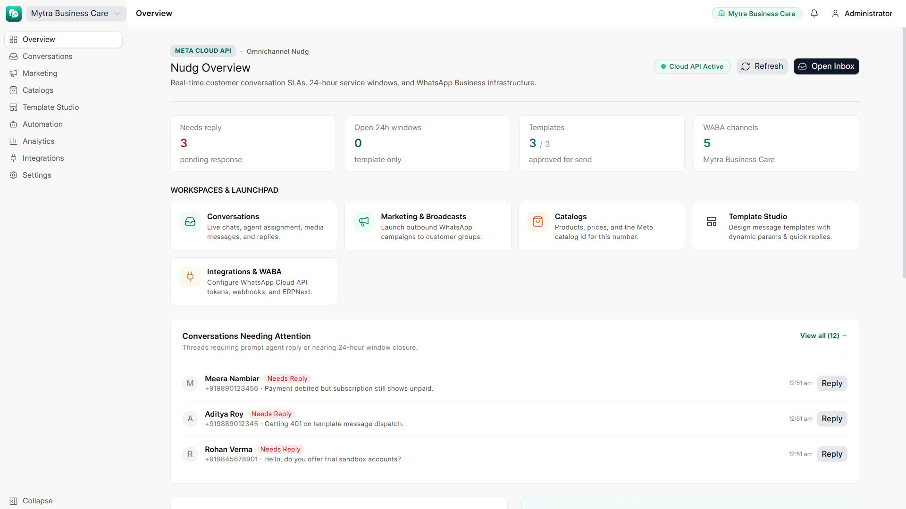
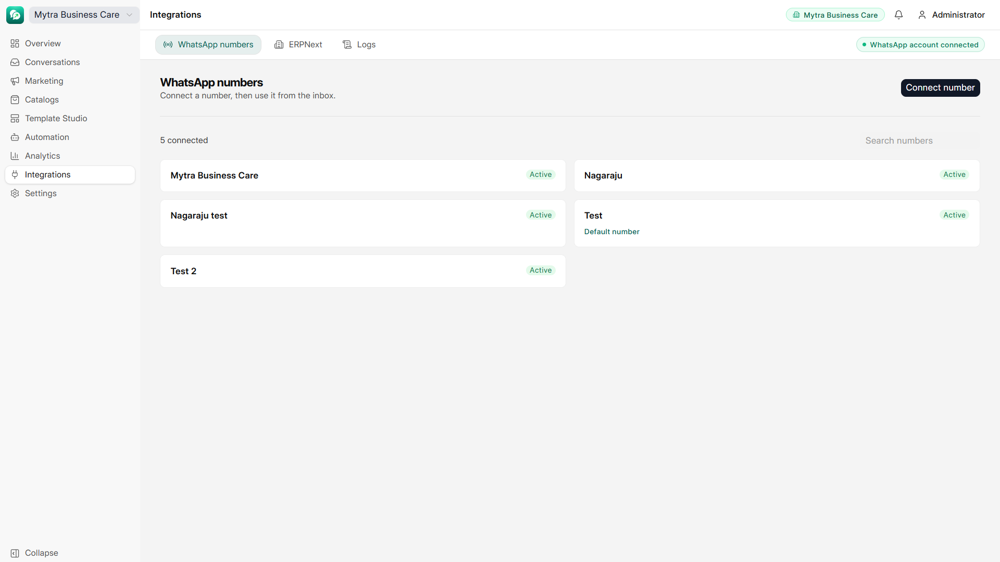
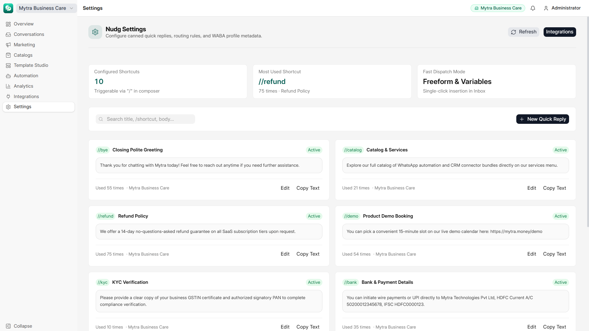
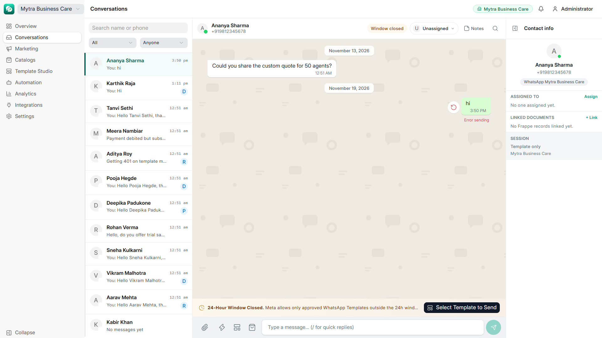

Stay inside [/nudg](/nudg). Each step below is one screen. You can click the link and do it while you read.

## 1. See whether WhatsApp is live

Open **Overview**. The pill at the top says **Cloud API Active** when a number is connected. **Setup Required** means the inbox has nothing to receive yet.

:::note
**Needs reply** and **Open 24h windows** are the work for today. Templates and WABA channels are the setup behind that work.
:::

## 2. Connect a number if the pill is not green

Open **Integrations**. **Connect number** is on the right. Use **Login with Facebook**, or **I already have credentials** if you already have the phone number ID and token.

The **All numbers** menu at the top of every page is how you limit the rest of the app to one of these accounts. A number marked **Default number** is the fallback, not a number everyone can suddenly use.

Details: [Connect a number](../integrations/connect-a-number.md).

## 3. Put the team on the site

A System Manager gives **WhatsApp User** to agents and **WhatsApp Manager** to the person who connects numbers and runs campaigns. Add them from **Settings → Team & Agents**.

Agents live in Conversations. They do not need Desk.

## 4. Save one quick reply

Open **Settings**. **New Quick Reply** takes a title, a shortcut, and the text. In a thread, type `/` and pick it.

## 5. Answer one thread

Open **Conversations**. Pick a row.

- **Window open** — type in the box and send.
- **Window closed** — the amber bar is Meta refusing a free-form reply. Use **Select Template to Send**.

## 6. After the first reply

| Next | Screen |
| --- | --- |
| Check how a template will look | [Template Studio](../template-studio/overview.md) |
| Send that template to a list | [Marketing](../marketing/overview.md) |
| Add a product you can drop into a chat | [Catalogs](../catalogs/overview.md) |
| Turn on a default reply for one number | [Automation](../automation/overview.md) |
