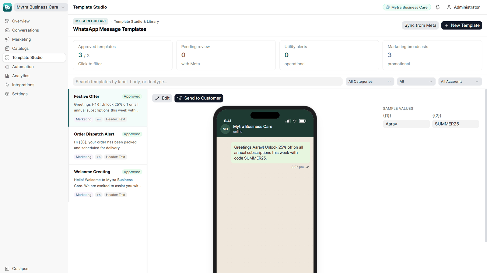

Template Studio is where you read an approved WhatsApp template, fill its variables, and see the message on a phone before anyone receives it.

WhatsApp only delivers a business-initiated message after Meta approves the template. A template that is still pending cannot be sent. **Sync from Meta** pulls the latest review state onto this site.

## What the cards mean

| Card | Meaning |
| --- | --- |
| Approved templates | Ready to send. Click the card to filter the list to them. |
| Pending review | Submitted, not approved yet. |
| Utility alerts | Operational templates, such as an order update. |
| Marketing broadcasts | Promotional templates. These are the ones campaigns should use. |

Search matches the label, the body, and a linked DocType. Filter by category and by WhatsApp account when you have more than one number.

## Fill it, then send

1. Click a template in the list. **Festive Offer** in the picture is a marketing template with a header and two variables.
2. The phone preview updates as you type the sample values. `{{1}}` and `{{2}}` on the right become the name and the code in the green bubble.
3. **Send to Customer** delivers it. **Edit** changes the template record. Editing an approved template can send it back to Meta for review.

Buttons on the template (a quick reply, a link, or a phone number) are part of the approval. You do not rewrite them here.

:::tip[Same template, three doors]
From a thread whose window is closed, **Select Template to Send** opens this library for one person. From **Marketing**, **New Campaign** sends one template to a list. Studio is where you check the wording first.
:::

A template can be tied to a DocType such as Lead. Sending it links that document on the conversation. See [Assignment and notes](../conversations/assignment-and-notes.md).

Create and submit new templates with **New Template**, then wait for Meta. Until the status is **Approved**, the send stays disabled. **Save draft** keeps it on this site. **Submit to Meta** is the step that sends it for review.

